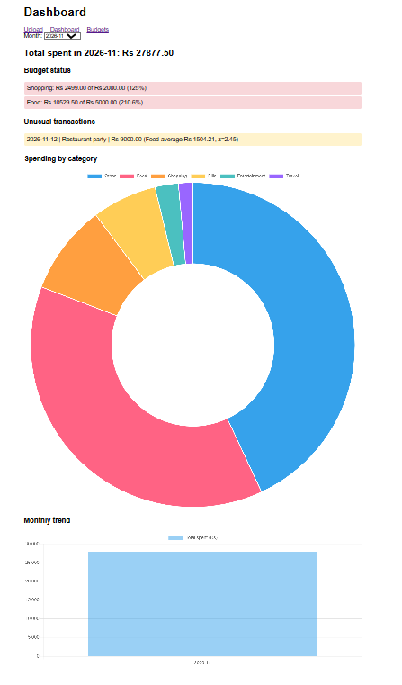
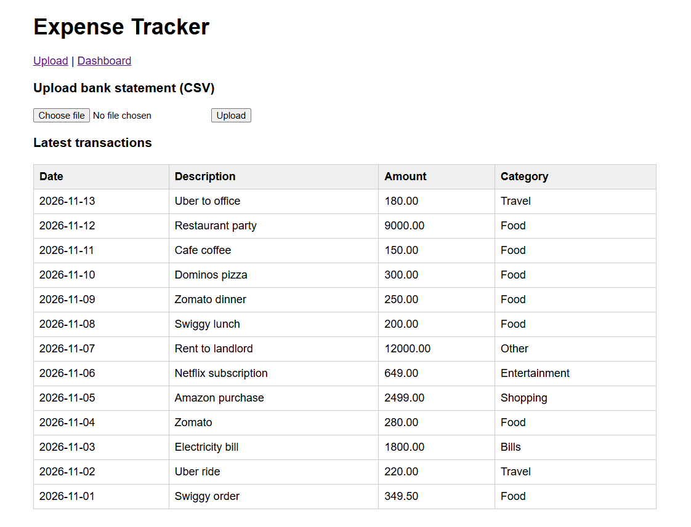

# Expense Intelligence Tracker

A Flask + MySQL web app that turns raw bank-statement CSV files into spending insights: automatic categorization, monthly analytics, budget alerts, and unusual-spend detection.

## Features

- **CSV import** with validation (bad rows skipped, negative amounts rejected, 5 MB limit)
- **Duplicate protection**: re-uploading the same file never double-counts transactions
- **Auto-categorization** using editable keyword rules (Food, Travel, Bills, ...)
- **Dashboard** with category doughnut chart and monthly trend (Chart.js)
- **Budget alerts**: warning at 80%, danger at 100% of a monthly limit
- **Unusual-spend detection** using Z-scores per category
- **Automated tests** with pytest (11 tests)

## Tech stack

Python 3.13, Flask, SQLAlchemy, MySQL, Pandas, Chart.js, pytest, Git

## Architecture

```
Browser (HTML + Chart.js)
        |
   Flask routes (app/routes.py)       <- HTTP, validation, JSON APIs
        |
   Services (app/services/)           <- business logic
     csv_service, categorizer, analytics, insights
        |
   SQLAlchemy models (app/models.py)  <- ORM
        |
      MySQL
```

## Database design

- `categories` (id, name, keywords)
- `transactions` (id, date, description, amount, category_id -> categories)
- `budgets` (id, category_id -> categories, monthly_limit)

`amount` uses `DECIMAL(12,2)` to avoid floating-point rounding errors.

## How to run locally

```bash
git clone https://github.com/anika932/expense-tracker.git
cd expense-tracker
python -m venv venv
venv\Scripts\activate
pip install -r requirements.txt
```

1. Create a MySQL database: `CREATE DATABASE expense_tracker CHARACTER SET utf8mb4;`
2. Copy `.env.example` to `.env` and fill in your MySQL password (encode `@` as `%40`).
3. Start the app: `python run.py`
4. Open http://127.0.0.1:5000 and upload `test_statement.csv`.

## Run tests

```bash
pytest
```

## How anomaly detection works

For each category, the app computes the mean and standard deviation of all amounts. A transaction with Z-score = (amount - mean) / std >= 2 is flagged. Categories with fewer than 3 transactions are skipped because there is not enough history.

## Screenshots




## Future improvements

- User login and per-user data
- PDF bank statement parsing
- Docker deployment
- Editable categories from the UI